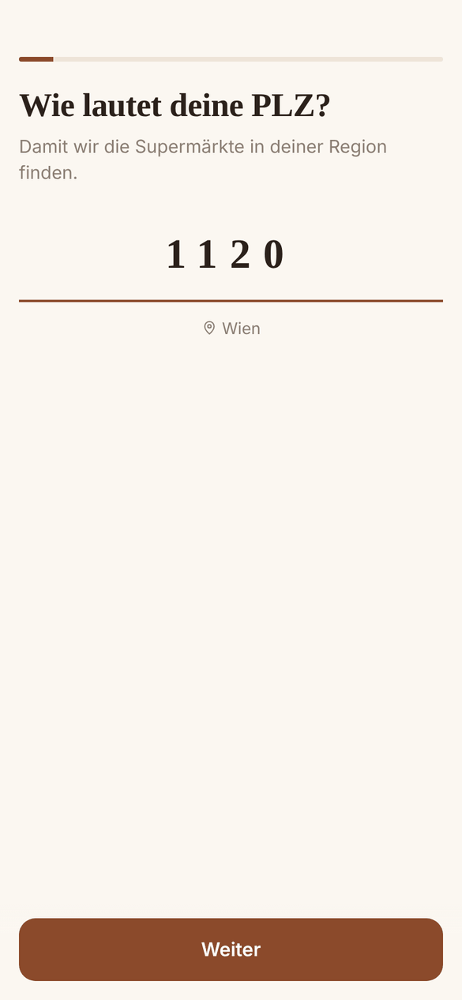
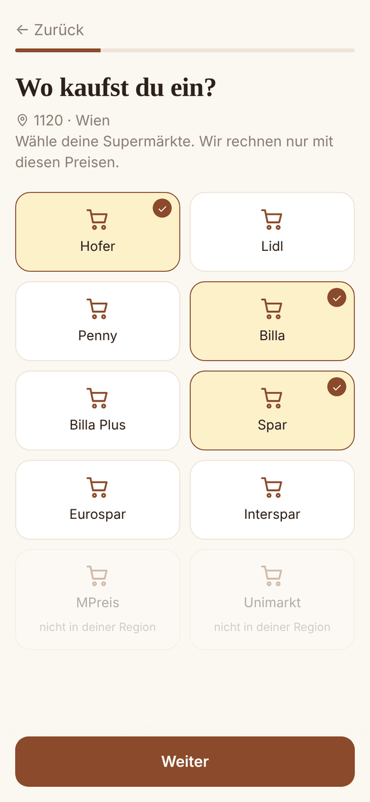
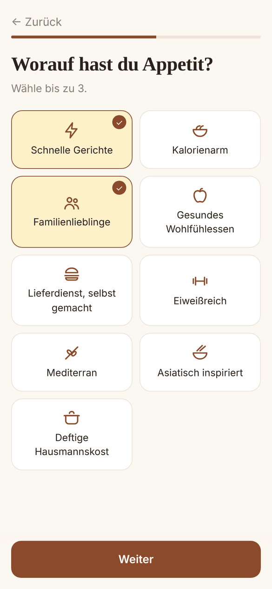
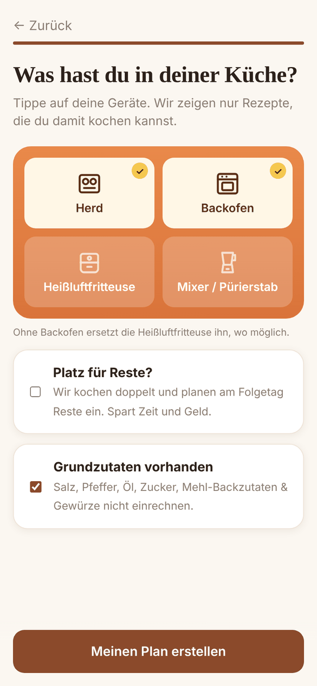
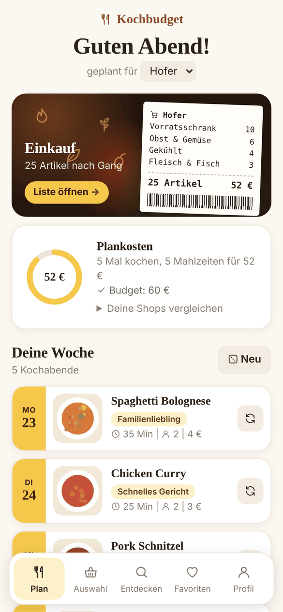
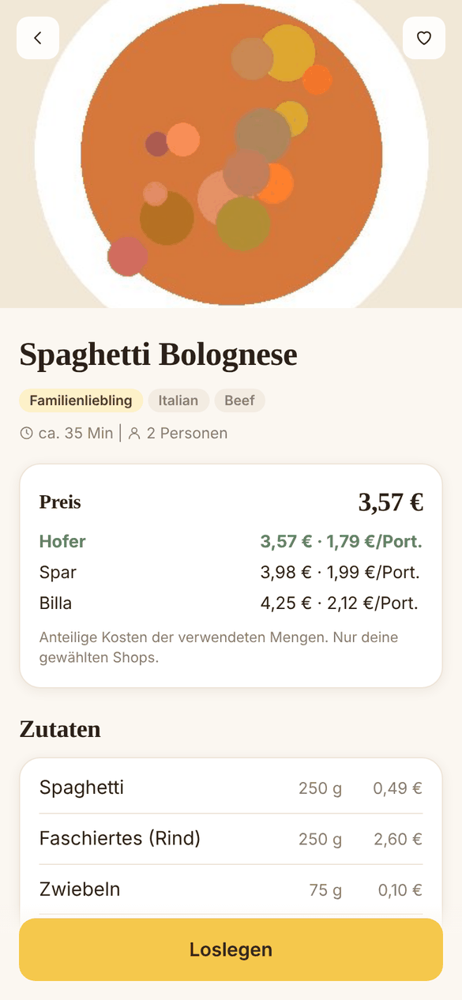
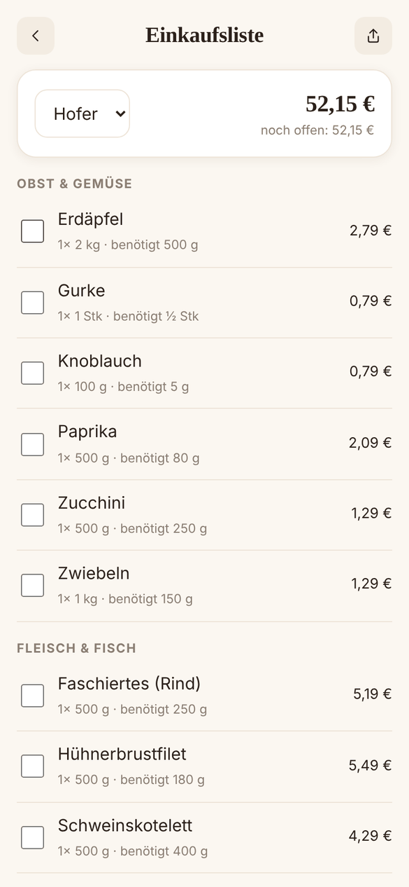
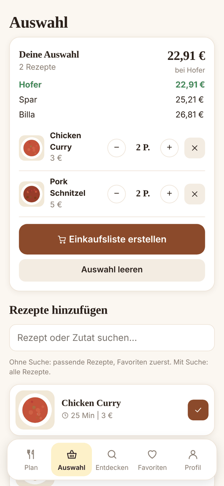

<p align="center">
  
</p>

<h1 align="center">Kochbudget</h1>

<p align="center">
  Wochenplan, Rezepte und Einkaufsliste – mit Preisen <b>deiner</b> Supermärkte in Österreich.<br>
  <a href="https://brickey8171.github.io/Kochen/"><b>App öffnen →</b></a>
</p>

<p align="center">
  
  
  
  
</p>

---

Kochbudget fragt dich ein paar Dinge – Postleitzahl, Supermärkte, Budget, Küchengeräte, Geschmack – und stellt daraus einen Wochenplan zusammen, der in dein Budget passt. Dazu gibt es eine fertige Einkaufsliste, sortiert nach Regal, mit Preisen für die Shops, in denen du wirklich einkaufst.

Die ganze App ist eine einzige HTML-Datei ohne Server, ohne Konto und ohne Tracking. Alle Angaben bleiben auf deinem Gerät.

## Screenshots

| Einrichtung | | | |
|:-:|:-:|:-:|:-:|
|  |  |  |  |
| **Wochenplan** | **Rezept** | **Einkaufsliste** | **Auswahl** |
|  |  |  |  |

<sub>Screenshots mit Beispieldaten und Platzhalterbildern. In der App kommen Rezepte und Fotos von TheMealDB.</sub>

## Funktionen

**Einrichtung (wie ein kurzer Fragebogen)**
- Postleitzahl → Region; regionale Ketten wie MPreis oder Unimarkt erscheinen nur dort, wo es sie gibt
- Supermärkte: Hofer, Lidl, Penny, Billa, Billa Plus, Spar, Eurospar, Interspar, MPreis, Unimarkt
- Erwachsene und Kinder, Kochtage, Wochenbudget
- Appetit (bis zu 3), maximale Kochzeit (bis 100 Min), Ernährung (vegetarisch, vegan, pescetarisch)
- Was du nicht isst, Allergien, Küchengeräte (Herd, Backofen, Heißluftfritteuse, Mixer)
- „Platz für Reste?“ – doppelt kochen und am Folgetag Reste einplanen

**Wochenplan**
- Plan unter deinem Budget, ein Gericht pro Kochtag
- Einzelne Gerichte tauschen oder ganzen Plan neu würfeln
- Plankosten mit Budget-Ring und Preisvergleich zwischen deinen Shops

**Rezepte**
- Zutaten auf Deutsch, in metrischen Mengen, umgerechnet auf deine Personenzahl
- Preis pro Rezept und Portion, Vergleich zwischen deinen Shops
- Anleitung übersetzen und Schritt-für-Schritt-Kochmodus („Loslegen“)
- Favoriten und Suche („Entdecken“)

**Einkaufslisten**
- Wocheneinkauf nach Regal sortiert, ganze Packungen gerechnet, abhakbar, teilbar
- Tab **Auswahl**: beliebige Rezepte mit eigener Portionszahl auswählen → eigene Einkaufsliste

**Offline-App (PWA)**
- Auf dem Handy zum Home-Bildschirm hinzufügen und wie eine App öffnen
- Funktioniert nach dem ersten Start auch ohne Internet

## Installieren aufs Handy

1. [brickey8171.github.io/Kochen](https://brickey8171.github.io/Kochen/) öffnen (einmal mit Internet)
2. **iPhone (Safari):** Teilen → „Zum Home-Bildschirm“
   **Android (Chrome):** Menü ⋮ → „App installieren“
3. Ab jetzt wie eine normale App öffnen – auch offline

## Woher kommen die Daten?

| Was | Quelle | Hinweis |
|---|---|---|
| Rezepte & Fotos | [TheMealDB](https://www.themealdb.com) | Englisch, international; Zutaten werden ins Deutsche übertragen |
| Preise | [heisse-preise.io](https://heisse-preise.io) | Aktuelle Preise österreichischer Ketten, falls erreichbar |
| Preise (Fallback) | Schätzwerte in der App | Werden genutzt, wenn keine Live-Preise verfügbar sind |
| Übersetzungen | [MyMemory](https://mymemory.translated.net) | Kostenlos mit Tageslimit; Ergebnisse werden gespeichert |

Ein grüner Punkt neben einem Preis bedeutet Live-Preis, sonst ist es eine Schätzung. Zutaten werden automatisch Produkten zugeordnet – einzelne Preise können daher danebenliegen.

Falls die Live-Preise blockiert werden: In **Profil → Preise** die Datei `latest-canonical.json` von heisse-preise.io herunterladen und über „Preisdatei wählen“ laden.

## Was offline funktioniert

| Offline | Braucht Internet |
|---|---|
| App, Wochenplan, Auswahl, Einkaufslisten | Allererster Start (Rezepte laden) |
| Alle bereits geladenen Rezepte | Fotos von Rezepten, die du noch nie geöffnet hast |
| Bereits angesehene Fotos | Neue Übersetzungen |
| Zuletzt geladene Preise | Preise aktualisieren |

## Projektaufbau

```
.
├── index.html              # Die komplette App (HTML, CSS, JavaScript)
├── sw.js                   # Service Worker – speichert die App für offline
├── manifest.webmanifest    # Name, Farben und Icons für „Zum Home-Bildschirm“
├── icons/                  # App-Icons (192, 512, maskable, Apple, Favicon)
├── docs/screenshots/       # Bilder für diese README
├── .nojekyll               # GitHub Pages: Dateien unverändert ausliefern
├── CHANGELOG.md
└── LICENSE
```

## Selbst hosten / lokal starten

Es gibt keinen Build-Schritt. Für den Offline-Modus muss die App über `http(s)://` laufen, nicht als `file://`.

```bash
git clone https://github.com/Brickey8171/Kochen.git
cd Kochen
python3 -m http.server 8000
# → http://localhost:8000
```

**GitHub Pages:** Settings → Pages → Source „Deploy from a branch“ → Branch `main`, Ordner `/ (root)`.

**Updates veröffentlichen:** Einfach `index.html` ersetzen und pushen. Die App lädt online immer die neueste Version und speichert sie für offline. Wenn du `sw.js` selbst änderst, erhöhe dort `VERSION` (z. B. `'v2'`), damit alte Caches aufgeräumt werden.

## Datenschutz

- Kein Konto, keine Cookies, kein Tracking, keine Werbung
- Deine Angaben (PLZ, Budget, Allergien usw.) werden nur lokal im Browser gespeichert (`localStorage`)
- Die App lädt nur Daten von TheMealDB, heisse-preise.io, MyMemory und Google Fonts
- „Profil → Alles zurücksetzen“ löscht alle gespeicherten Daten

## Bekannte Grenzen

- Rezepte sind international und englischsprachig, Titel und Schritte werden automatisch übersetzt
- Kochzeiten werden aus der Anleitung geschätzt
- Allergie-Filter sind eine Hilfe, kein Ersatz für das Lesen der Zutatenliste
- TheMealDB wird mit dem öffentlichen Test-Schlüssel genutzt; für eine größere öffentliche App sieht TheMealDB einen eigenen Schlüssel (Supporter) vor

## Lizenz

Der Code steht unter der [MIT-Lizenz](LICENSE). Rezepte, Fotos und Preisdaten gehören den jeweiligen Quellen und fallen nicht unter diese Lizenz.
